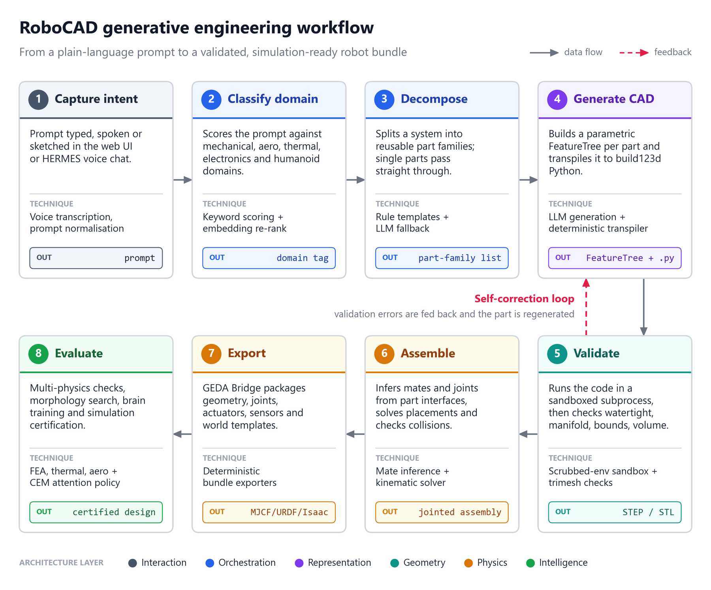
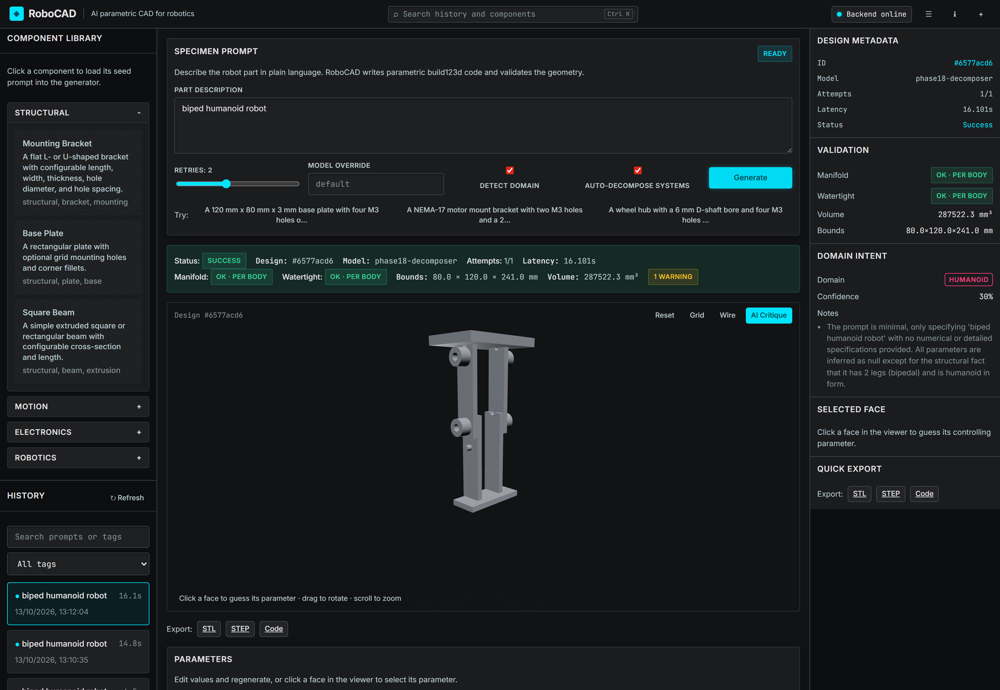
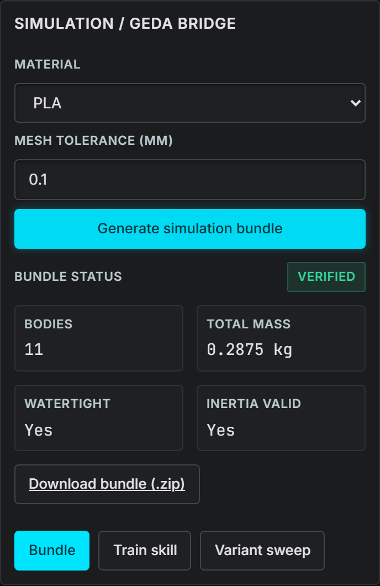
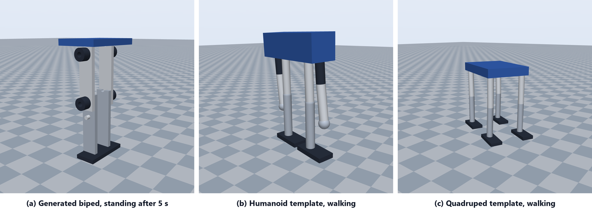
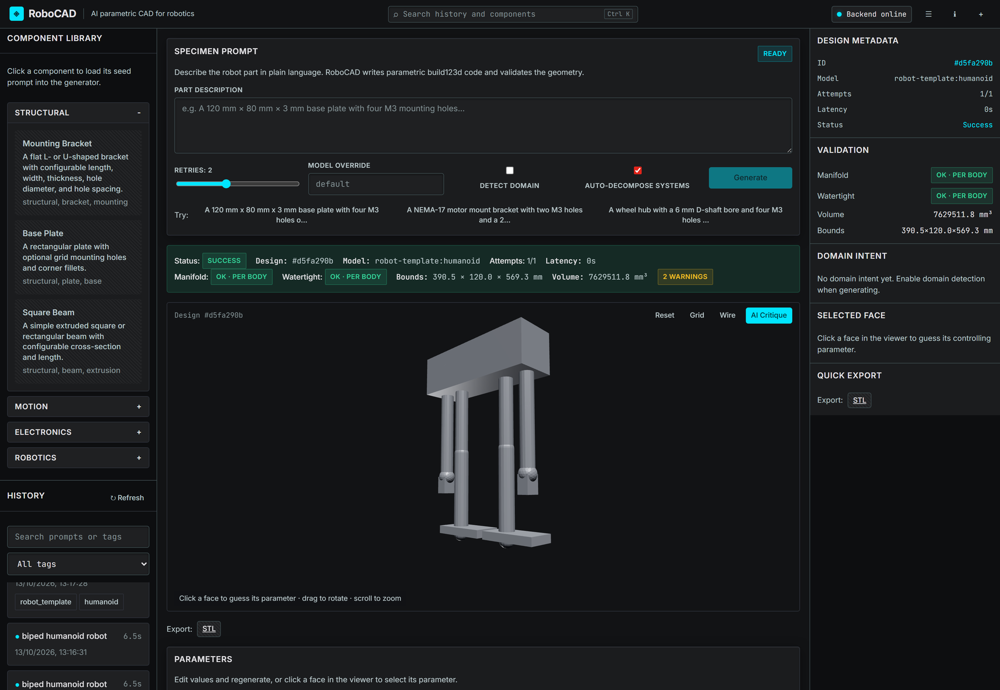
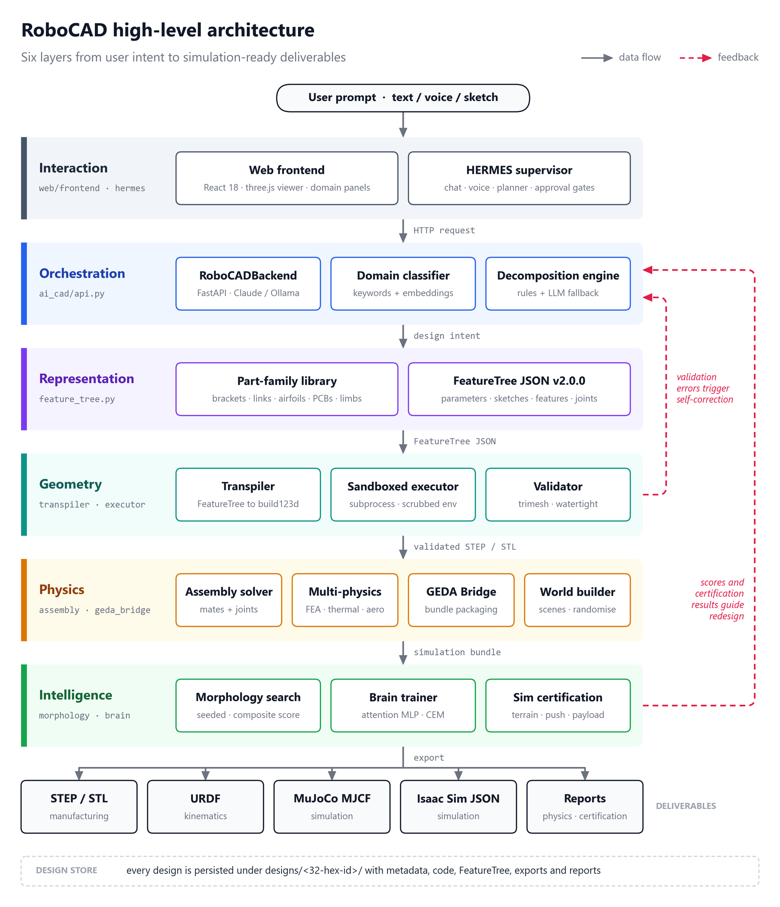

# 🤖 RoboCAD — AI-Powered Generative Engineering for Robotics

> **Mission:** Let robotics builders design real, editable, manufacturable hardware parts and whole robots by describing them in plain language, then take those designs straight into physics simulation.
>
> **Core bet:** The AI writes **parametric CAD code** (build123d), not throwaway meshes. The model you get is editable, versionable, and exportable for 3D printing, machining, Onshape, or MuJoCo / URDF / Isaac Sim.

**Status (13 October 2026):** type `biped humanoid robot` and RoboCAD returns an upright, articulated biped built from real CAD parts, exports it as a verified MuJoCo + URDF bundle with 6 revolute joints and 6 actuators, and that bundle stands on its own feet in simulation. See [What it does today](#-what-it-does-today), [Verified results](#-verified-results) and [Known limitations](#%EF%B8%8F-known-limitations) for exactly what is and is not proven.



---

## 📸 What it does today

### 1. Prompt to articulated robot in the browser



The prompt `biped humanoid robot` with **Detect domain** and **Auto-decompose systems** ticked:

- The domain classifier labels the prompt **HUMANOID**.
- The rule-based decomposer splits it into five part families: torso plate, hip hub, thigh, shin and foot.
- The composer places **11 part instances** as an upright biped (X forward, Y left, Z up, soles on the ground) with **10 mates** and **10 joints** (6 revolute: `hip_pitch`, `knee`, `ankle` on each leg; 4 fixed hub attachments).
- Thigh and shin form lap joints in neighbouring planes, so the knee can swing through its range without the bars interfering.
- Every body passes the watertight and manifold checks. The status strip shows **OK · per body**, because a multi-part preview is validated body by body rather than as one solid.
- The viewer is Z-up, so robots stand on the grid instead of lying on their side.

`quadruped walker` produces a four-legged version with 12 revolute joints through the same path. Adding `with arms and gripper hands` to the biped prompt adds shoulder, upper-arm, forearm and hand parts.

### 2. One click to a verified simulation bundle



**Generate simulation bundle** runs the GEDA Bridge on the design and reports the result: 11 bodies, 0.2875 kg total mass computed from the part geometry, all meshes watertight, all inertia tensors valid. The bundle (`model.mjcf`, `model.urdf`, meshes, manifest) downloads as a zip.

### 3. The exported robot in MuJoCo



| Panel | Robot | What the simulation shows |
|---|---|---|
| (a) | The biped generated from the prompt above | 11 bodies, 6 revolute joints, 6 actuators. With a free base, ground contact and position servos it stands on its own soles for 5 simulated seconds with **0.08° maximum tilt** and 0.16 mm height change, and recovers from a lateral push scaled to its mass. |
| (b) | Humanoid robot template | Walking rollout used by the physics scorer: **0.075 m forward in 100 control steps**, 5.7° maximum pitch/roll. |
| (c) | Quadruped robot template | Walking rollout: **0.25 m forward in 600 control steps**, 10.3° maximum pitch/roll. |

Individual stills: [generated biped](docs/images/mujoco_generated_biped_standing.png), [humanoid template](docs/images/mujoco_humanoid_template_walking.png), [quadruped template](docs/images/mujoco_quadruped_template_walking.png).

### 4. Robot templates in the viewer



The **Humanoid / robot synthesis** panel creates parameterised humanoid, quadruped and manipulator-on-base templates. These are **kinematic skeletons** (link frames, joints, mass budget) used by morphology search, gait synthesis and brain training. They now show in the viewer and in MuJoCo with proportioned capsule-and-box link geometry derived from the skeleton, instead of 1 cm placeholder cubes. The geometry is for display only; inertial data and simulation behaviour are unchanged.

---

## 🧩 What RoboCAD can do

| Area | Capability |
|---|---|
| **Input** | Text prompt, voice (LiveKit / NVIDIA), sketch or reference image, parameter edits, face-click parameter guessing |
| **Understanding** | Keyword + embedding domain classification (mechanical, aero, thermal, electronics, humanoid); per-domain intent parsing |
| **Decomposition** | Rule templates for quadcopters, robot arms, bipeds, quadrupeds, fixed-wing aircraft and electronics stacks; LLM fallback for unknown systems |
| **Geometry** | FeatureTree JSON (schema 2.0.0) transpiled to build123d; sandboxed execution with scrubbed environment; trimesh validation; STEP / STL export |
| **Assembly** | Layout and mate inference from part-family interfaces, kinematic joints, pose sampling, pairwise collision and clearance checks |
| **Physics checks** | Lightweight structural FEA, thermal, aerodynamic and electronics analysis; optional CalculiX, ElmerFEM and OpenFOAM adapters |
| **Simulation export** | GEDA Bridge bundles for MuJoCo MJCF, URDF and Isaac Sim JSON, with world and scene templates and domain randomisation |
| **Robot intelligence** | Morphology search with physics scoring, gait synthesis for the robot templates, CEM-trained attention policies, simulation certification |
| **Supervision** | HERMES conversational supervisor with planner, tool registry and approval gates; one-prompt auto-orchestration |
| **Product** | One-command launcher, health check CLI, asset marketplace, Onshape upload |



---

## ✅ Verified results

Measured on 13 October 2026 on the branch that introduced the fixes below.

| Check | Result |
|---|---|
| Default pytest tier | **427 passed** (287 deselected by marker). This run started before the URDF rewrite and the last two backend edits. |
| New layout and export tests (`tests/test_humanoid_layout.py`) | **9 passed**, including a MuJoCo test that the generated biped stays upright for 5 s and a test that URDF and MJCF describe the same robot |
| Generated biped, MJCF vs solved assembly | Every body pose matches the assembly solver to within 1 µm and 1e-6 in rotation |
| Generated biped, URDF vs MJCF | Mesh poses agree to within 0.2 µm at rest and with all six hinges rotated by 0.3 rad |
| Humanoid template, URDF vs MJCF | Mesh poses agree to within 1e-9 m at rest and with all 14 hinges rotated |
| Template walking | Humanoid 0.0747 m (100 steps) and quadruped 0.2520 m (600 steps): identical to the values before the changes |
| Frontend build | `npm run build` succeeds |
| Heavy / slow / MuJoCo pytest tier | **Not completed on this code.** A partial run reached about 106 of 287 tests with no failures before it was stopped. |

---

## ⚠️ Known limitations

- **Generated robots stand but do not walk.** The gait controller is tuned for the skeleton templates. A biped or quadruped generated from real part geometry passes the standing and push tests but fails the stepping and walking tests.
- **Template walking is short-horizon.** The humanoid template is validated over a 100-step rollout and falls in a 600-step rollout. This was already the case before the changes described here.
- **Template geometry is not manufacturable.** Template links are capsules and boxes for display. Only robots produced through the prompt path have real CAD parts.
- **Generated bipeds are small.** Part families use fixed default dimensions (150 mm limb segments), so the default biped is about 0.24 m tall and weighs 0.29 kg in PLA.
- **Template end links stay behind.** Hands on the humanoid template are exported as static bodies, a pre-existing quirk the gait tuning depends on. They are hidden from the default MuJoCo render groups.
- **Simulation only.** No hardware-in-the-loop validation has been done (Phase 27D remains blocked on hardware).
- **Heavy test tier not re-verified** on the latest code, as noted above.

---

## 🔧 What changed in the 13 October 2026 update

Before this update the prompt `biped humanoid robot` produced a torso plate floating above two bars lying flat, the UI reported an overconstrained assembly with 0 joints, and the exported MuJoCo model had no joints or actuators.

| Area | Fix |
|---|---|
| Composer | Humanoid and quadruped layout is computed from the real part dimensions; limb bars hang vertically and are joined as lap joints; each layout mate carries its joint definition, which is emitted as a kinematic joint named for the gait controllers (`hip_pitch_l`, `knee_l`, `ankle_l`, …) |
| Assembly solver | Mates placed by a layout are marked locked, so the solver keeps the explicit transforms instead of pulling part origins together |
| Assembly transpiler | Rotations are emitted in the angle convention build123d expects, so compound rotations are correct; string parameters such as `gait_style` are quoted |
| MJCF export | Body poses, joint anchors and joint axes are expressed in the rotated parent and child frames; parts attached by fixed joints are nested under their parent body |
| URDF export | Rewritten: each link frame sits at its joint, with mesh and inertial offsets, so the URDF reproduces the MJCF kinematics |
| Template visuals | Skeleton links get proportioned display meshes; robot templates write a viewer preview |
| Physics scorer | Recognises generated robots; they keep their real masses, stand on their actual soles, and use an implicit integrator with rotor inertia; the push test scales with robot mass |
| Backend | HERMES session creation no longer fails when a parameter has no description; rebuilding a skeleton template returns a clear error instead of a crash |
| Frontend | Z-up viewer; per-body validation badges; simulation-bundle request no longer times out on multi-part robots |

---

## 🧑‍💻 Author

**Satyam Das** — CS grad, quant/AI engineer, aspiring roboticist.

* GitHub: [@satyamdas03](https://github.com/satyamdas03)
* Sister project: [LearningRobotics](https://github.com/satyamdas03/LearningRobotics) — where the theory behind these parts is learned chapter by chapter.
* Motto: *"Think in systems, design in language, build in hardware."*

---

## 🔗 Why this exists / connection to LearningRobotics

`LearningRobotics` is a public learning journal that walks through robotics fundamentals — C-space, rigid-body motions, kinematics, dynamics, and eventually control + RL. The natural next step after *understanding* a robot is to *build* it. But professional CAD has a steep activation energy: weeks of UI muscle memory before you can express a simple idea like:

> *"A 120 mm × 80 mm × 3 mm base plate with four M3 mounting holes on a 100 mm × 60 mm grid and two NEMA-17 motor mounts."*

RoboCAD closes that gap. It lets me (and anyone else) operate at the level of intent, not clicks. Designs produced here can be:

1. Printed or machined directly (STL / STEP / 3MF export).
2. Synced to Onshape for professional assemblies and mates (Phase 5).
3. Loaded into MuJoCo / Isaac Sim for physics and skill training (Phases 14A–24).
4. Inspected, critiqued, and driven by a conversational supervisor (HERMES, Phases 26–27A).

In short: **LearningRobotics teaches the robot. RoboCAD designs the parts and systems.**

---

## ✨ What makes this different

| Tool category | Examples | Output | Editable? | Manufacturable? | Sim-ready? |
|---|---|---|---|---|---|
| Text-to-mesh | Meshy, Shap-E | mesh (STL-like) | ❌ no | ⚠️ limited | ❌ no |
| Text-to-SDF/voxel | research demos | implicit field | ❌ no | ❌ no | ❌ no |
| Parametric template filling | Onshape configs | existing parametric model | ✅ yes | ✅ yes | ⚠️ limited |
| **RoboCAD (this repo)** | **LLM → build123d code → feature tree → multi-physics → assembly → world model** | **parametric CAD script + verified bundle** | **✅ yes** | **✅ yes** | **✅ yes** |

The key insight: **CAD is code.** Modern parametric kernels (OpenCASCADE via build123d/CADQuery, Onshape's FeatureScript) are programming environments. LLMs are already excellent at code generation. RoboCAD turns hardware design into a code-generation + execution + verification problem, which is exactly the right shape for an AI researcher.

---

## 🏗️ Architecture

```
┌─────────────────────────────────────────────────────────────────────────┐
│  User layer                                                             │
│  • natural-language / voice / sketch prompt                             │
│  • parameter sliders / stylus reference points                        │
│  • design history + remix + HERMES conversational supervisor          │
└───────────────────────────┬─────────────────────────────────────────────┘
                            │
                            ▼
┌─────────────────────────────────────────────────────────────────────────┐
│  AI orchestrator (Claude / GPT-4 / NVIDIA Nemotron + structured output)  │
│  • domain classification (mechanical / aero / thermal / electronics /   │
│    humanoid / multi)                                                   │
│  • intent parsing + system decomposition                                │
│  • emits parametric build123d code + feature tree                     │
│  • self-corrects on execution / validation failures                     │
│  • explains what it built and why                                     │
└───────────────────────────┬─────────────────────────────────────────────┘
                            │
                            ▼
┌─────────────────────────────────────────────────────────────────────────┐
│  CAD execution + domain geometry engine                                 │
│  • build123d solids, sketches, constraints, assemblies                │
│  • surface geometry for airfoils / wings / heat sinks / propellers     │
│  • PCB outlines, enclosures, connectors for electronics co-design       │
│  • humanoid / quadruped / manipulator robot templates                  │
└───────────────────────────┬─────────────────────────────────────────────┘
                            │
                            ▼
┌─────────────────────────────────────────────────────────────────────────┐
│  Multi-physics verification layer                                       │
│  • material library, mesh-quality gate                                  │
│  • closed load-case templates: static stress, drop test, thermal, CFD, │
│    fatigue, fastener pull-out, joint torque                              │
│  • redesign suggestions when a check fails                              │
└───────────────────────────┬─────────────────────────────────────────────┘
                            │
                            ▼
┌─────────────────────────────────────────────────────────────────────────┐
│  Assembly + world-model bridge                                        │
│  • mate inference, kinematic solver, collision / clearance checks        │
│  • MJCF / URDF export with joints, actuators, sensors                   │
│  • MuJoCo + Isaac Sim world templates, domain randomization, terrain    │
│  • attention-based robot brain training (CEM + NumPy)                 │
└───────────────────────────┬─────────────────────────────────────────────┘
                            │
                            ▼
┌─────────────────────────────────────────────────────────────────────────┐
│  Collaboration + deployment                                             │
│  • Onshape REST sync, manufacturability reports                         │
│  • verified bundle export for LearningRobotics                          │
│  • real-time voice agent via LiveKit + NVIDIA NIM                       │
│  • AI render critique + physics-aware scenario generation               │
└─────────────────────────────────────────────────────────────────────────┘
```

---

## 🛠️ Tech stack

| Layer | Technology | Rationale |
|---|---|---|
| CAD kernel | **build123d** | Clean Python API on OpenCASCADE; LLMs write it well; open-source |
| Mesh validation | `trimesh`, `manifold3d` | Watertight checks, mass properties |
| AI models | Claude 5 / GPT-4 / NVIDIA Nemotron / Ollama | Best-in-class code generation + local fallback |
| Backend | FastAPI | Python-native, easy to invoke build123d |
| Frontend | React + three.js / react-three-fiber | Standard web 3D viewer with professional rendering |
| Speech | LiveKit + NVIDIA NIM ASR/TTS | Real-time WebRTC voice with cloud STT/TTS |
| Simulation | MuJoCo + Isaac Sim JSON | Physics-ready bundles and world models |
| Storage | JSON files + Git | Simple, versioned, portable |
| Export formats | STL, STEP, 3MF, MJCF, URDF, IDF | 3D printing / machining / Onshape / simulation / EDA |

---

## 🚀 Phase-by-phase progress

> The tables and phase notes from here down are the historical build log. Test counts in them are the counts at the time each phase closed. For the current, measured state see [Verified results](#-verified-results) and [Known limitations](#%EF%B8%8F-known-limitations) above.

| Phase | Goal | Status |
|---|---|---|
| **0** | Validate the AI → parametric-code loop in Python | ✅ **Complete — 8/8 prompts pass** |
| **1** | Robust generation + self-correction backend | ✅ **Complete — 19/20 prompts pass (95%)** |
| **2** | Minimal web app (prompt + viewer + export) | ✅ **Complete — FastAPI + React + three.js viewer + persistence** |
| **3** | Parameter / stylus editing layer | ✅ **Complete — editable parameter panel + face-click parameter guessing + versioned regeneration** |
| **4** | Design library + remix | ✅ **Complete — component catalog, search/filter, tags, remix with parent linking** |
| **5** | Onshape export / sync + manufacturing reports | ✅ **Complete — HMAC-signed Onshape API client, STEP upload, manufacturability report** |
| **6** | Robotics-aware component templates | ✅ **Complete — 12 standard robotics parts in `ComponentLibrary`** |
| **7** | Google Stitch Kinetic Precision UI redesign | ✅ **Complete — dark scientific workstation, `kp-*` token system, frontend build passes** |
| **8** | Complexity benchmark + feature-tree spec | ✅ **Complete — 30-prompt baseline: 26/30 (86.7%); feature-tree schema v1.0.0** |
| **9** | Feature-tree backend | ✅ **Complete — structured feature tree transpiles to build123d; 97/97 tests pass** |
| **10** | Sketch + 2D constraint solver | ✅ **Complete — internal 2D solver for distance/horizontal/vertical/coincident/concentric/equal/fix constraints; 105/105 tests pass** |
| **11** | Assembly system | ✅ **Complete — multi-part instances + LCS mates; 112/112 tests pass** |
| **12** | Verification + physics layer | ✅ **Complete — DFM rule engine, tolerance/fit checks, cantilever-beam FEA; 125/125 tests pass** |
| **13** | Model specialization / fine-tuning + Claude 5 integration | ✅ **Complete — 134/134 tests pass; Claude Sonnet 5 T1–T4 87.5%** |
| **14A** | GEDA Bridge: MuJoCo / URDF exporter + verified asset bundles | ✅ **Complete — 152/152 tests passing** |
| **14B** | Standard manipulation scene templates | ✅ **Complete — 160/160 tests passing** |
| **15A** | LearningRobotics handshake | ✅ **Complete — 170/170 tests passing** |
| **15B** | RoboCompiler asset pipeline | ✅ **Complete — 187/187 tests passing** |
| **16** | Cross-domain input (voice/text/sketch + domain detection) | ✅ **Complete — 201/201 tests passing** |
| **17** | Domain-aware parametric representation | ✅ **Complete — feature-tree schema v2.0.0; 201/201 tests passing** |
| **18** | Automatic decomposition + domain part families | ✅ **Complete — 228/228 tests passing** |
| **19** | Mechanical assembly synthesis + verification | ✅ **Complete — 251/251 tests passing** |
| **20** | Aerodynamics, thermal, and propulsion geometry | ✅ **Complete — 276/276 tests passing** |
| **21** | Electronics and mechatronics integration | ✅ **Complete — 299/299 tests passing** |
| **22** | Multi-physics verification engine | ✅ **Complete — 330/330 tests passing** |
| **23** | Humanoid and full-robot system synthesis | ✅ **Complete — 357/357 tests passing** |
| **24** | World-model simulation builder | ✅ **Complete — 376/376 tests passing** |
| **25** | Robot brain training loop | ✅ **Foundation complete — 414/414 tests passing across default, heavy/slow, and mujoco tiers** |
| **26** | HERMES cross-domain conversational supervisor | ✅ **Complete end-to-end — real tool executors, parameter validation, design context, LLM caller (Anthropic/Ollama), design-feedback loop, `HermesPanel`; 450/451 tests passing** |
| **27A** | Voice interface for HERMES (LiveKit + NVIDIA NIM) | ✅ **Landed — LiveKit token endpoint, NVIDIA STT/TTS adapters, room-based voice agent, `VoiceControls.jsx`; 15 tests** |
| **27B** | Professional rendering hardening | ✅ **Landed — auto-fit camera, studio lighting, contact shadows, reset/grid/wireframe toolbar, screenshot capture** |
| **27C** | NVIDIA model intelligence | ✅ **Landed — generic NIM client, AI render critique, HERMES NVIDIA routing, `/world/scenario`, `/nvidia/models`; 15 tests** |
| **27D** | Hardware-in-the-loop sim-to-real | ⏳ **Future — blocked on hardware access** |
| **28A** | Launcher + installer + health CLI | ✅ **Complete — one-command start.py/start.bat/start.sh, python -m robocad.health** |
| **28B** | Asset marketplace | ✅ **Complete — verified parts/scene/robot templates, upload/download/import** |
| **28C** | Deep multi-physics engine | ✅ **Complete — CalculiX FEA, ElmerFEM thermal, OpenFOAM CFD, NVIDIA surrogate, deep verification UI** |
| **28D** | Morphology Co-Design Lab | ✅ **Complete — parametric morphology search, stability/workspace/gait scoring, world-model + brain smoke-test integration, backend endpoints + frontend panel; 15 tests** |
| **28E** | Simulation certification | ✅ **Complete — real-solver dispatch, readiness score, certificates, field/report export; 15 tests** |
| **28F** | Product hardening + final docs | ✅ **Complete — marketplace archive upload, solver install bootstrap, health hints, onboarding tests** |
| **29** | Physics-based morphology scoring | ✅ **Complete — MuJoCo standing/sway/step rollouts; humanoid passes end-to-end; score 7.6/10** |
| **30** | Real gait synthesis and validation | ✅ **Complete — balance-aware walking controller produces >5 cm forward locomotion for default biped + quadruped templates; walk_score weighted into morphology composite; honest validation revised score 7.7/10 (default-template walk OK, grid/perturbation/backend flow still brittle)** |
| **Milestone A** | Adaptive gait robustness | ✅ **Complete — morphology-aware gait params/balance gains, per-candidate gait sweep, mass-aware actuator gains, quadruped trot gait; humanoid grid ≥40%, quadruped grid ≥75%, mass perturbations ≥50% walk pass rate; score 7.7 → 8.0/10** |
| **Milestone B** | Structural dynamics / FEA for links | ✅ **Complete — link cross-section extraction, cantilever/simply-supported beam bending + Euler buckling, `structural_score` in morphology composite, optional deep CalculiX dispatch on top-N; score 8.0 → 8.3/10** |
| **Milestone C** | Workspace / self-collision / manipulability | ✅ **Complete — sagittal-plane workspace proxy, representative-pose self-collision checks, topology-aware Yoshikawa-style manipulability index; composite weights revised; score 8.3 → 8.5/10** |
| **Milestone D** | Real end-effector families | ✅ **Complete — `parallel_jaw_gripper`, `three_finger_hand`, `vacuum_gripper`, `point_foot`, `compliant_foot` part families; `_attach_end_effector` swaps real families into the tree; end-effector mass influences actuator/structural scoring; frontend selector; MuJoCo export/load regression; score 8.5 → 8.7/10** |
| **Milestone E** | Topology grammar beyond templates | ✅ **Complete — deterministic `Topology`/`LimbSpec`/`JointSpec` grammar, `enumerate_topologies` with physical pruning, `topology_to_feature_tree` composer, `TopologySpace` + topology-aware `search_morphologies`, backend `/morphology/topologies` + topology search, frontend topology mode; hexapod/wheeled topologies load in MuJoCo and score non-zero; score 8.7 → 9.0/10** |
| **Milestone F** | Real MuJoCo brain training on generated robots | ✅ **Complete — `WorldReplayEnv` MuJoCo wrapper with robot-specific observation/action spaces, `RobotMLPPolicy` with variable dims, NumPy-only CEM `train_robot_policy`, reward functions for walker/humanoid/push tasks; `/morphology/{id}/candidates/{id}/simulate` trains on the actual generated MJCF; score 9.0 → 9.3/10** |
| **Milestone G** | Automatic simulation certification | ✅ **Complete — `ai_cad/robot_certification.py` with deterministic randomized-world cases (terrain walking, push recovery, drop test, actuator saturation, payload lift); integrated into `ai_cad/sim_certification.py`; auto-cert on `/morphology/search` top candidate and optional `/generate` for robots; `CertificationPanel.jsx` + API helpers; score 9.3 → 9.6/10. Post-ship demo `scripts/demo_morphology_walk.py` runs the real physics scorer path and captures MuJoCo walking frames for humanoid and quadruped designs.** |
| **Milestone I** | Voice/text-to-certified-design orchestration | ✅ **Complete — HERMES `AutoOrchestrator` from a single prompt through domain classification → morphology search → MuJoCo brain smoke test → randomized-world simulation certification, with retry/mutation on failure; onboarding `WelcomePanel`; `POST /hermes/session/{id}/auto` + `/audit`; default suite 410 passing; heavy/slow/mujoco suite 276 passed + 1 xfailed + 2 xpassed; score 9.6 → 9.7/10. Milestone H (sim-to-real) remains blocked on hardware access.** |

Phases 0–7 proved the **AI → parametric-code loop** for single-part robotics hardware. Phases 8–13 turned that loop into an **engineer-grade CAD system** with feature trees, constraints, assemblies, verification, and model specialization. Phases 14A–15B shipped the **GEDA Bridge** so LearningRobotics can consume verified simulation-ready assets. Phases 16–27C expanded RoboCAD into a **multi-domain generative engineering platform** with a real-time voice supervisor, NVIDIA-powered intelligence, and professional rendering. Phases 28A–F and 29–30 turned it into a **simulation-first product platform** with a physics-validated morphology co-design lab that scores robots by whether they can actually walk.

---

## 🎯 Why we follow this sequence

This roadmap is the canonical plan of record for RoboCAD. **Do not reorder phases or skip ahead without explicit user approval.** Every phase is load-bearing:

- **Phase 13** is the quality gate. We do not build the bridge until the generator reliably produces correct feature trees.
- **Phases 14A–15B** (PATH1) are the first commercial milestone. They prove that AI-generated CAD can be consumed by real physics simulators and create the exact bundle format that later vision layers need.
- **Phases 16–17** add cross-domain input and a domain-aware parametric core. Without these, aero/thermal/electronics/humanoid features have no shared data model.
- **Phases 18–23** add domain-specific tracks (mechanical assembly, aero/thermal geometry, electronics integration, multi-physics verification, humanoid/robot synthesis).
- **Phases 24–27C** close the world-model → brain-training → HERMES voice/intelligence loop without requiring hardware.
- **Phase 27D** is the hardware-in-the-loop sim-to-real step, intentionally separated so the software stack can mature first.
- **Phase 28** re-scoped into a **simulation-first product platform**: launcher/marketplace (28A/B), real FEA/CFD/thermal solvers (28C), morphology co-design lab (28D), simulation certification (28E), and final product hardening (28F).

---

## 🧭 Decision record: PATH1 before PATH2

We explicitly decided to ship **PATH1 (GEDA Bridge, Phases 14A–15B) first**, then expand into the full **voice/world-model-to-robot platform (Phases 16–28)**. The reasoning is:

1. **Risk-ordering.** PATH1 is plumbing and unit conversion; the expanded PATH2 bundles multiple unsolved research problems (decomposition, arbitrary multi-physics, RL training, humanoid morphology, sim-to-real).
2. **Market validation.** PATH1 addresses a visible $4–5 B market gap (CAD → MuJoCo / URDF). The broader robotics design platform market is larger but crowded and capital-intensive.
3. **Foundation for the multi-domain vision.** PATH1 produces the bundle schema, verified asset format, and LearningRobotics API contract that mechanical, aero, electronics, and humanoid layers depend on.
4. **Ship-first discipline.** Every phase must produce something a user or partner can run. PATH1 satisfies that immediately.

See [`PLAN.md`](PLAN.md) Section 14 for the full PATH1 vs PATH2 analysis, and [`dossiers/PATH1_PATH2_analysis.md`](dossiers/PATH1_PATH2_analysis.md) for the detailed market/technical write-up.

---

## 🎙️ Phase 27A — Voice interface for HERMES

RoboCAD now supports real-time voice conversations with HERMES:

- **LiveKit** room-based agent: the frontend joins a `hermes-{session_id}` room, publishes microphone audio, and receives agent replies.
- **NVIDIA NIM STT** (`nemotron-asr-streaming`) transcribes user speech.
- **HERMES backend** handles the intent and returns a text response.
- **NVIDIA NIM TTS** (`chatterbox-multilingual-tts`) speaks the reply back to the user.
- Text transcripts from both sides are mirrored into the `HermesPanel` chat history via LiveKit data channels.
- Backend endpoint: `POST /hermes/session/{id}/livekit-token`.

Files: `ai_cad/hermes/livekit_token.py`, `ai_cad/hermes/nvidia_voice.py`, `ai_cad/hermes/voice_plugins.py`, `ai_cad/hermes/voice_agent.py`, `web/frontend/src/components/VoiceControls.jsx`.

---

## 🖼️ Phase 27B/C — Rendering hardening + NVIDIA intelligence

The 3D viewer and simulation pipeline are now backed by NVIDIA NIM models:

- **Professional rendering** in `STLViewer.jsx`: auto-fit camera via `@react-three/drei/Bounds`, hemisphere + directional lighting, `ContactShadows`, reset/grid/wireframe controls, and `preserveDrawingBuffer` for screenshots.
- **AI render critique**: click **AI Critique** to capture the canvas, send it to a NVIDIA vision-language model, and get a structured score, issue list, and suggestions (clipping, orientation, lighting, proportions).
- **NVIDIA NIM client** (`ai_cad/nvidia_client.py`) provides chat, vision, and Cosmos physics-aware scenario generation.
- **HERMES can use NVIDIA models**: set `ROBOCAD_MODEL` to a NVIDIA model ID (e.g., `nvidia/nemotron-3.5-lightning-30b-a3b`) and HERMES routes through the NIM client.
- **Scenario generation endpoint** `POST /world/scenario` uses Cosmos to generate physics-aware scenario descriptions from text or image prompts.
- **Model catalog endpoint** `GET /nvidia/models` lists the NIM IDs RoboCAD knows how to use.

---

## 🔬 Phase 28C/E/F — Simulation-first product platform

RoboCAD now dispatches real engineering solvers, certifies designs, and ships as a hardened product:

- **Real FEA/CFD/thermal solvers** via `ai_cad/solvers/verification_deep.py`:
  - `solver_mode`: `auto` (real if installed, else surrogate), `real` (fail if missing), `surrogate` (no binaries needed).
  - **CalculiX** static/modal stress, **ElmerFEM** thermal conduction/stress, **OpenFOAM** drag/lift.
  - Coarse bounding-box analysis mesh runs without Gmsh/Netgen; full meshers used when available.
  - Graceful fallback to lightweight estimates + surrogate when solvers are absent.
- **Scalar field extraction + viewer heatmaps** (`ai_cad/solvers/field_export.py`):
  - Parses CalculiX `.dat`, Elmer `.ep`, OpenFOAM coefficients.
  - Maps values to STL vertices; `STLViewer.jsx` renders vertex-color heatmaps.
- **Simulation certification** (`ai_cad/sim_certification.py`):
  - Runs a suite of closed load cases across real/surrogate solvers.
  - Weighted readiness score + real-vs-surrogate A/B comparison.
  - Persisted certificates under `certificates/{cert_id}.json`.
- **Professional reports** (`ai_cad/solvers/report_export.py`):
  - Markdown reports from any deep-verify job via `GET /designs/{id}/deep-verify/{job_id}/report.md`.
- **Marketplace archive upload**:
  - `POST /marketplace/upload` accepts `.zip`/`.tar.gz`/`.tgz`, extracts to `marketplace/uploads/{uuid}/`, creates catalog entry.
  - Frontend `MarketplacePanel.jsx` file input + `uploadMarketplaceArchive` API helper.
- **Solver install bootstrap**:
  - `python scripts/setup_solvers.py --check` shows what is installed.
  - `python scripts/setup_solvers.py` attempts platform-native installs on Ubuntu/Debian/Arch/macOS; Windows prints download links.
  - `docs/SOLVER_INSTALL.md` covers licensing, install steps, and troubleshooting.
  - `python -m robocad.health` prints solver versions + install hints.
- **Onboarding tests**:
  - `tests/test_onboarding.py`, `tests/test_health.py`, `tests/test_setup_solvers.py` verify launcher, health CLI, solver bootstrap, and backend `/health`.

Files: `ai_cad/solvers/verification_deep.py`, `ai_cad/solvers/field_export.py`, `ai_cad/solvers/report_export.py`, `ai_cad/sim_certification.py`, `ai_cad/marketplace.py`, `scripts/setup_solvers.py`, `docs/SOLVER_INSTALL.md`, `robocad/health.py`, `web/backend/main.py`, `web/frontend/src/components/VerificationPanel.jsx`, `web/frontend/src/components/STLViewer.jsx`, `web/frontend/src/components/MarketplacePanel.jsx`.

---

## 🛠️ Getting started

```bash
# 1. Clone
$ git clone https://github.com/satyamdas03/RoboCAD.git
$ cd RoboCAD

# 2. Install Python dependencies
$ pip install -r requirements.txt

# 3. Add API keys to a .env file at the repo root
#    ANTHROPIC_API_KEY=...
#    NVIDIA_API_KEY=...          # optional, for voice + vision + scenarios
#    LIVEKIT_URL=...             # optional, for voice
#    LIVEKIT_API_KEY=...
#    LIVEKIT_API_SECRET=...

# 4. One-command start (recommended)
$ python start.py
# Or on Windows: start.bat
# Or on Linux/macOS: ./start.sh

# 5. Or run backend + frontend manually
$ python -m web.backend.main        # terminal 1
$ cd web/frontend && npm run dev     # terminal 2

# 6. Check environment health
$ python -m robocad.health
```

Prompts to try once the frontend is open at `http://localhost:5173` (tick **Detect domain**, leave **Auto-decompose systems** on):

| Prompt | Result |
|---|---|
| `biped humanoid robot` | Upright articulated biped, 11 parts, 6 revolute joints |
| `quadruped walker` | Four-legged robot, 21 parts, 12 revolute joints |
| `biped humanoid robot with arms and gripper hands` | Biped with shoulder, arm and hand parts |
| `robot arm with gripper` | Serial arm with a parallel-jaw gripper |
| `A 120 mm x 80 mm x 3 mm base plate with four M3 holes` | Single parametric part |

Then press **Generate simulation bundle** in the Simulation / GEDA Bridge panel to export MJCF and URDF. Robot templates are created from the **Humanoid / robot synthesis** panel, which appears once a design is selected.

Run tests:

```bash
# Default (fast) suite — excludes heavy, slow, mujoco, benchmark, network tests
$ python -m pytest

# Heavy / slow / mujoco tiers (must override the default marker exclusion)
# On Windows PowerShell:
$ python -m pytest tests -m "heavy or slow or mujoco" --tb=short

# On Linux/macOS:
$ python -m pytest tests -m 'heavy or slow or mujoco' --tb=short

# Frontend build
$ cd web/frontend && npm run build
```

---

## 📁 Repository layout

```
RoboCAD/
├── ai_cad/                  # Core AI + CAD engine
│   ├── hermes/              # HERMES conversational supervisor (Phases 26–27A)
│   ├── geda_bridge/         # Simulation bundle + world model (Phases 14A–25)
│   ├── solvers/             # Deep FEA/CFD/thermal solver adapters (Phase 28C)
│   ├── marketplace.py       # Asset marketplace backend (Phase 28B)
│   ├── nvidia_client.py     # NVIDIA NIM client (Phase 27C)
│   ├── render_critique.py   # AI render critique (Phase 27C)
│   ├── assembly.py          # Assembly + mate system (Phases 11, 19)
│   ├── decomposition.py     # System decomposer (Phase 18)
│   ├── part_families.py     # Domain part-family registry (Phase 18)
│   ├── feature_tree.py      # Parametric feature-tree schema (Phases 9, 17)
│   ├── sketch_solver.py     # 2D constraint + airfoil solver (Phases 10, 17)
│   ├── verification*.py     # Multi-physics verification (Phase 22)
│   └── materials.py         # Shared material library (Phase 22)
├── web/
│   ├── backend/main.py      # FastAPI backend
│   └── frontend/src/        # React + three.js app
├── marketplace/             # Verified asset packs and marketplace index (Phase 28B)
├── robocad/                 # Launcher, health CLI, installer builder (Phase 28A)
├── tests/                   # Pytest suite
├── docs/                    # Contracts, schemas, session recovery
├── dossiers/                # Public strategic write-ups
├── PLAN.md                  # Full roadmap and trade-offs
└── README.md                # This file
```

---

## 📋 Roadmap at a glance

| Phase | What it does | ~Time | Proof point |
|---|---|---|---|
| **13** | Benchmark to ≥80% on T1–T4, close extractor edge cases | 1–2 mo | Quality gate passed — T1–T4 87.5% with Claude Sonnet 5 |
| **14A** | MuJoCo/URDF exporter + verified asset bundles | 2–3 mo | Simulation-ready CAD |
| **14B** | Standard manipulation scene templates | 1 mo | Drop-in task templates |
| **15A** | LearningRobotics bundle handshake | 1–2 mo | Cross-repo verified handoff |
| **15B** | RoboCompiler asset pipeline | 2–3 mo | Video → custom part → trained skill smoke test; variant sweep + skill recommendation live |
| **16** | Cross-domain input (voice/text/sketch + domain detection) | 2–3 mo | Mechanical, aero, electronics, humanoid intents routed correctly |
| **17** | Domain-aware parametric representation | 3–4 mo | Feature tree supports solids, surfaces, kinematics, PCB form factors |
| **18** | Automatic decomposition + domain part families | 3–4 mo | System intents split into domain-specific parts; 12 reusable part families; 228/228 tests |
| **19** | Mechanical assembly synthesis + verification | 3–4 mo | Mate inference + kinematic solver + collision checks + joint-aware export; 251/251 tests |
| **20** | Aerodynamics, thermal, and propulsion geometry | 3–4 mo | Airfoil / wing / heat sink / propeller + CFD mesh export |
| **21** | Electronics and mechatronics integration | 2–3 mo | PCB form-factor / enclosure / connector co-design |
| **22** | Multi-physics verification engine | 4–6 mo | Structural / thermal / CFD / dynamic checks; 330/330 tests |
| **23** | Humanoid and full-robot system synthesis | 4–6 mo | Biped / quadruped / manipulator system export |
| **24** | World-model simulation builder | 3–4 mo | Cross-domain training scenes |
| **25** | Synthetic data + policy training loop | 4–6 mo | Design → trainable brain |
| **26** | HERMES cross-domain conversational supervisor | 3–4 mo | Complete end-to-end — real tool executors, parameter validation, design context, LLM caller, redesign loop; 450/451 tests |
| **27A–C** | Voice + NVIDIA intelligence + professional rendering | 2–3 mo | LiveKit voice for HERMES, NVIDIA NIM chat/vision/Cosmos, AI render critique, professional 3D viewer |
| **27D** | Hardware-in-the-loop sim-to-real | 6–12 mo | Real robot deployment (requires hardware access) |
| **28** | Distribution + commercialization + advanced co-design plugins | Ongoing | SaaS + marketplace |

---

## 🚀 Phase 28A/B/C — Simulation-first product platform

Phase 28 was re-scoped from pure packaging to a **simulation-first product platform**.

### 28A — Launcher + health CLI + installer skeleton

- `python start.py` / `start.bat` / `start.sh` starts backend + frontend with one command.
- `python -m robocad.health` reports Python version, dependencies, API keys, and solver availability.
- `scripts/build_installer.py` produces a PyInstaller desktop bundle.

### 28B — Asset marketplace

- Built-in marketplace for verified parts, scene templates, robot templates, and trained policy bundles.
- Backend CRUD + import endpoints; frontend `MarketplacePanel.jsx` grid with verified badges.
- Starter packs include a bracket, `gripper_cube_grasp` scene, and `manipulator_on_base` robot template.

### 28C — Deep multi-physics engine

- Optional real solver adapters under `ai_cad/solvers/`:
  - **CalculiX** (`calculix_adapter.py`) for static/modal FEA.
  - **ElmerFEM** (`elmerfem_adapter.py`) for thermal conduction and thermal-stress.
  - **OpenFOAM** (`openfoam_adapter.py`) for CFD drag/lift.
  - **NVIDIA surrogate** (`nvidia_surrogate.py`) for sub-second approximate analysis.
- Async SQLite job store (`job_store.py`) with submit/status/cancel/poll.
- Backend endpoints: `POST /designs/{id}/deep-verify`, `GET /designs/{id}/deep-verify/{job_id}`, `POST /designs/{id}/deep-verify/{job_id}/cancel`, `GET /designs/{id}/solver-availability`.
- Frontend "Deep Analysis" tab in `VerificationPanel.jsx`.

Residual caveats: real external solvers are optional; missing solvers produce valid input decks and graceful "not installed" messages. Safety-critical parts still require human engineering review.

---

## 🏆 Milestones A–G: from walking robots to certified robots

RoboCAD's post-Phase-30 work is organized into a series of **honest-score milestones** that each close a measurable gap in generative robot design.

### Milestone A — Adaptive gait robustness
Morphology-aware gait scaling, per-candidate gait sweep, mass-aware actuator gains, and quadruped trot gait. The default humanoid grid reaches ≥40% walk pass rate, the quadruped grid reaches ≥75%, and mass perturbations stay ≥50%. Score: **7.7 → 8.0/10**.

### Milestone B — Structural dynamics / FEA for links
Link cross-section extraction, cantilever and simply-supported beam bending, Euler buckling, and `structural_score` integrated into the morphology composite. Optional deep CalculiX dispatch on top-N candidates. Score: **8.0 → 8.3/10**.

### Milestone C — Workspace / self-collision / manipulability
Sagittal-plane workspace proxy, representative-pose self-collision checks, and a topology-aware Yoshikawa-style manipulability index. Composite scoring weights revised. Score: **8.3 → 8.5/10**.

### Milestone D — Real end-effector families
`parallel_jaw_gripper`, `three_finger_hand`, `vacuum_gripper`, `point_foot`, and `compliant_foot` part families. `_attach_end_effector` swaps real families into the FeatureTree; end-effector mass influences actuator and structural scoring. Frontend selector + MuJoCo export/load regression. Score: **8.5 → 8.7/10**.

### Milestone E — Topology grammar beyond templates
Deterministic `Topology` / `LimbSpec` / `JointSpec` grammar, `enumerate_topologies` with physical pruning, `topology_to_feature_tree` composer, `TopologySpace` + topology-aware `search_morphologies`, backend `/morphology/topologies`, and frontend topology mode. Hexapod and wheeled topologies load in MuJoCo and score non-zero. Score: **8.7 → 9.0/10**.

### Milestone F — Real MuJoCo brain training on generated robots
`WorldReplayEnv` MuJoCo wrapper with robot-specific observation/action spaces, `RobotMLPPolicy` with adaptive dims, NumPy-only CEM `train_robot_policy`, reward functions for walker/humanoid/push tasks. Backend `/morphology/{search_id}/candidates/{candidate_id}/simulate` trains on the actual generated MJCF. Score: **9.0 → 9.3/10**.

### Milestone G — Automatic simulation certification with randomized worlds
`ai_cad/robot_certification.py` runs deterministic MuJoCo stress cases (terrain walking, push recovery, drop test, actuator saturation, payload lift) on every generated robot. Integrated into `ai_cad/sim_certification.py` as a weighted check; auto-cert on `/morphology/search` top candidate and optional `/generate` for robots; surfaced in `CertificationPanel.jsx`. Score: **9.3 → 9.6/10**.

**Post-ship demo:** `scripts/demo_morphology_walk.py` makes the walking behavior visible end-to-end. It runs a fast heuristic morphology search, scores top candidates with the same `physics_score_candidate` path used internally, and captures MuJoCo frames through a safe `step_callback` hook. Key lesson: frame-capture callbacks must **not** call `mujoco.mj_forward()` after `mujoco.mj_step()` because it overwrites the solver warm-start and destabilizes the walk. Run it with:

```bash
python -u scripts/demo_morphology_walk.py
```

Outputs land in `demo_output/morphology_walk/`.

### Milestone I — Voice/text-to-certified-design orchestration
HERMES `AutoOrchestrator` (`ai_cad/hermes/orchestrator.py`) turns one voice or text prompt into a certified robot design without manual supervision. It classifies the domain, runs a physics-aware morphology search for robot/walker/humanoid/quadruped/manipulator prompts, trains a lightweight MuJoCo brain smoke test on the top candidate, runs randomized-world simulation certification, and retries with template/end-effector mutations on failure. Non-robot prompts flow through the conventional generate/verify/cert path. The onboarding hero (`WelcomePanel.jsx`) and HERMES auto-design form surface the pipeline end-to-end. Score: **9.6 → 9.7/10**.

### Launch readiness — Options A-D (in progress)
Post-Milestone I, the product is being hardened for launch across four axes:
- **A. Security:** path/ID validation middleware in `web/backend/main.py`, export containment, safe marketplace archive extraction, CORS tightening, subprocess env scrubbing, safe-eval AST replacement for `eval()` in `ai_cad/assembly.py`/`sketch_solver.py`/`morphology.py`, AST-based generated-code validation in `ai_cad/executor.py`, opt-in public-auth middleware (`ROBOCAD_ENABLE_PUBLIC_AUTH` + `ROBOCAD_API_KEY`), Onshape public-document opt-in, and HERMES auto-orchestration gating.
- **B. Reliability / resilience:** Windows `.env` loading fixed for `python start.py` and `python -m robocad.health`; backend defaults to `127.0.0.1` with reload disabled; frontend API requests get a 30 s timeout and JSON error parsing; `/health` returns minimal JSON by default with `?verbose=1` for the full launcher check list.
- **C. Honest-score verification:** default pytest suite re-run after all hardening changes — **412 passed, 280 deselected, 3 warnings**; heavy/slow/mujoco suite re-run in progress.
- **D. Frontend / UX:** emilkowalski design/animation skills installed and applied; valid HTML, `100dvh`, pointer-aware hover, `prefers-reduced-motion`, message overflow wrapping, SVG icons, stable React keys, missing Vite proxies, and mobile input font-size fixes.

**Note:** Milestone H (sim-to-real hardware-in-the-loop) remains future work blocked on hardware access.

---

## ⚠️ Security / secrets

All API keys live in the repo-root `.env` file, which is gitignored. Never commit keys. If a key has ever appeared in a plan file, chat export, or commit, **rotate it immediately** (regenerate the key in the provider console and update `.env`). The repository includes an advisory pre-commit hook to catch common secret patterns before they are committed:

```bash
# Enable the hook once per clone
$ git config core.hooksPath .githooks
```

The hook is advisory (non-blocking). It scans staged files for likely API keys and `.env`-like values and prints warnings; review its output before each commit.

Required/optional keys:

- `ANTHROPIC_API_KEY` (for generation and HERMES)
- `NVIDIA_API_KEY` (for STT/TTS, chat, vision, Cosmos)
- `LIVEKIT_URL`, `LIVEKIT_API_KEY`, `LIVEKIT_API_SECRET` (for voice rooms)
- Optional `ONSHAPE_ACCESS_KEY` / `ONSHAPE_SECRET_KEY` (for Onshape sync)

---

## 📜 License

MIT — see [`LICENSE`](LICENSE) if present, otherwise treat as open-source core with a future paid cloud tier.

---

*Built with care by Satyam Das and Claude Code. Test counts verified 2026-10-05 (Milestone I complete, launch readiness Options A–D in progress, local backend smoke-tested).*
