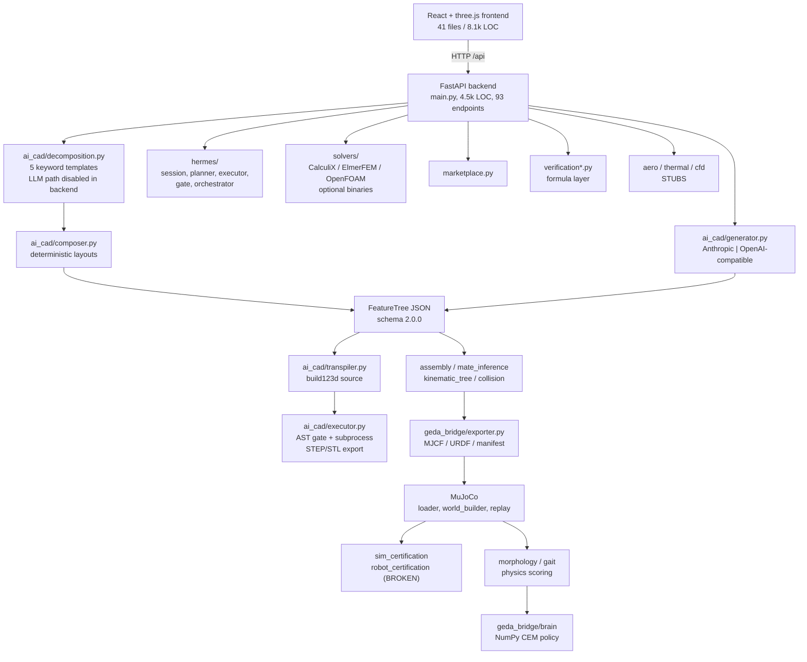

# RoboCAD — Session Context Report (Phase 2 deliverable)

**Date:** 2026-11-13
**Branch:** `master` @ `f56f66d` (last commit 2026-10-13)
**Author of this report:** session restart audit. Read-only; no product code changed.

**Evidence tags used below**

- `[verified: ran]` — I executed it on this machine in this session and saw the output.
- `[verified: read]` — I read the exact lines myself.
- `[audited]` — a read-only subagent read the module and quoted `file:line`; I did not
  re-open every line.
- `[claimed]` — a doc says so; no code or run backs it.

---

## 1. What RoboCAD is, and what it was meant to be

RoboCAD is a local FastAPI + React application that turns a plain-language prompt into
**editable parametric CAD code** (a `FeatureTree` JSON transpiled to build123d), exports
STEP/STL, and can emit physics bundles (MJCF / URDF / Isaac JSON). Around that core it has
accumulated a multi-domain shell: domain classification, part-family decomposition and
composition, assembly mating, DFV/FEA/CFD checks, electronics and aero geometry, a morphology
search with MuJoCo scoring, a CEM-trained "brain" smoke test, a HERMES conversational
supervisor with voice, an asset marketplace, and a launcher.

What it was meant to be (per `README.md`, `PLAN.md`): a voice/text/sketch → multi-domain
parametric CAD → multi-physics → assembly → world model → robot brain pipeline, shipped in
phases, with PATH1 (the GEDA Bridge: CAD → MuJoCo/URDF bundles) as the first commercial step
and PATH2 (generative multi-domain engineering) as the north star.

The **honest one-line state**: the single-part CAD loop and the MJCF/URDF export are real and
tested; the robot *design* layer is deterministic keyword templates, not generative design;
and one shipped feature (randomized-world robot certification) is broken on `master`.

---

## 2. Timeline, phase by phase

Reconstructed from 177 commits (`git log --reverse`, 2026-08-21 → 2026-10-13) and the docs.
"Status" is what the code/test evidence supports, not what the table in README says.

| Phase | Claimed deliverable | Status |
|---|---|---|
| 0 | AI → build123d loop, validator | `[claimed]` 8/8 prompts pass; the loop exists (`ai_cad/api.py`, `executor.py`) `[audited]` |
| 1 | Robust generation + self-correction | `[verified: read]` up to 3 generate/execute attempts (`api.py:52,140-194`) |
| 2 | FastAPI + React + three.js app | `[verified: ran]` backend imports and serves; frontend tree present |
| 3 | Parameter editing, face-click guessing | `[claimed]`; endpoint `/designs/{id}/guess-parameter` exists, no endpoint test `[audited]` |
| 4 | Design library + remix | `[verified: ran]` covered by `test_design_library.py` |
| 5 | Onshape sync + manufacturing report | `[audited]` real HMAC client (`ai_cad/onshape.py`), needs credentials |
| 6 | Robotics component templates | `[audited]` `ComponentLibrary` seeded |
| 7 | UI redesign (Stitch / Kinetic Precision) | `[claimed]`; `PRODUCT.md` documents the direction |
| 8 | Complexity benchmark + feature-tree spec | `[verified: read]` `benchmarks/complexity_ladder.json`, `prompts.json`, baseline report dated 2026-08-25 |
| 9–12 | Feature tree, sketch solver, assembly, verification | `[audited]` real data model + solver, with gaps (see §6) |
| 13 | Fine-tuning + Claude 5 | `[claimed]`; scaffolding scripts exist, benchmark ran against `claude-sonnet-5-*` |
| 14A–15B | GEDA Bridge bundles, scenes, handshake, RoboCompiler | `[audited]` MJCF/URDF exporter is real; Isaac loader is conditional |
| 16–17 | Domain classifier, schema v2.0.0 | `[audited]` real; classifier is keyword+embedding scoring |
| 18 | Decomposition + part families | `[audited]` 5 hardcoded templates + 29 families; **LLM path disabled in backend** |
| 19 | Assembly synthesis | `[audited]` mate inference real; `fixed`/`angle` mates skipped by the solver |
| 20 | Aero/thermal/propulsion | `[verified: read]` `aero.py`, `thermal.py`, `cfd.py` header comments call themselves **stubs** |
| 21 | Electronics/mechatronics | `[audited]` PCB outline + IDF writer real; analysis is formula-based |
| 22 | Multi-physics verification | `[audited]` formula layer real, closed load cases real |
| 23 | Humanoid synthesis | `[verified: ran]` biped decomposes and composes; layout real |
| 24 | World builder | `[audited]` MuJoCo + Isaac JSON export real |
| 25 | Brain training | `[audited]` NumPy CEM over a real MuJoCo env when `mujoco` is installed |
| 26 | HERMES supervisor | `[audited]` real LLM caller, real tool executor, server-side approval gates |
| 27A–C | Voice, NVIDIA, rendering | `[audited]` real HTTP adapters; require keys |
| 27D / Milestone H | Sim-to-real | Not started (hardware-blocked) |
| 28A–F | Launcher, marketplace, deep solvers, morphology lab, certification, hardening | Mixed: launcher/marketplace/solvers real; certification **broken** (§5) |
| 29–30 | Physics morphology scoring, gait | `[audited]` real MuJoCo rollouts for humanoid+quadruped templates only |
| A–G, I | Gait robustness, structural, workspace, end-effectors, topology, brain, certification, orchestration | Code present `[audited]`; certification broken `[verified: ran]` |

---

## 3. Architecture (as built)

**Dependency reality:** `build123d` + `trimesh` are required for everything; `mujoco` is
optional and only needed for physics scoring, certification, brain training and world loading;
external solvers are optional and fall back to surrogate estimates.

---

## 4. Module-by-module: real vs stub, and coverage

Counts: `ai_cad/` 104 files / 34,678 lines; `web/backend/main.py` 4,498 lines;
frontend 41 files / 8,116 lines; `tests/` 95 files / 13,558 lines.

| Module | Real / Stub / Partial | Evidence | Tests |
|---|---|---|---|
| `generator.py` | **Real** — actual Anthropic SDK and OpenAI-compatible HTTP calls | `[audited]` `generator.py:38-43, 199-205` | benchmark + unit |
| `executor.py` | **Real subprocess**, weak sandbox | `[audited]` `executor.py:224-235`; bypasses listed §7 | `test_executor.py` |
| `feature_tree.py` | **Real schema**, shallow validation | `[audited]` `validate_tree` at `:346-364` | `test_feature_tree*.py` |
| `transpiler.py` | **Partial** — emits only the first part; pattern features are no-ops | `[audited]` `transpiler.py:51-55, 269-288` | `test_transpiler*.py` |
| `sketch_solver.py` | **Real** least-squares; parallel/perp/symmetric/tangent unimplemented | `[audited]` `sketch_solver.py:256-309` | `test_sketch_solver.py` |
| `decomposition.py` | **Partial** — 5 keyword templates, no LLM in backend | `[verified: ran]` probes §8 | `test_decomposition*` |
| `part_families.py` | **Real** programmatic parts (29 families) | `[audited]` `part_families.py:2102` | `test_part_families*.py` |
| `composer.py` | **Real** deterministic layouts | `[audited]` `composer.py:618` | `test_composer.py` |
| `assembly.py` | **Partial** — `fixed`/`angle` mates skipped | `[audited]` `assembly.py:225-226, 258-259` | `test_assembly.py` |
| `mate_inference.py` | **Partial** — rule engine real, LLM fallback returns `[]` | `[audited]` `mate_inference.py:188-195` | `test_mate_inference.py` |
| `geda_bridge/exporter.py` | **Real** MJCF/URDF/joints/actuators | `[audited]` `exporter.py:708, 798-861` | `test_geda_bridge*.py` |
| `geda_bridge/loader.py` | MuJoCo real; Isaac conditional | `[audited]` `loader.py:216-244` | runtime tests |
| `world_builder.py` | **Real** MuJoCo + Isaac JSON | `[audited]` `:504, :819` | `test_world_builder.py` |
| `morphology*.py`, `gait.py` | **Real** MuJoCo rollouts, 2 templates only | `[audited]` `gait.py:179,233,630` | slow/heavy suites |
| `robot_certification.py` | **Broken** — 2 of 5 cases raise `NameError` | `[verified: ran]` §5 | tests never assert pass |
| `sim_certification.py` | Real weighting; gives non-robots full 0.25 credit | `[audited]` `:337-339, 363` | `test_sim_certification.py` |
| `solvers/*` | CalculiX/Elmer real dispatch; OpenFOAM dicts stub; fallback estimates | `[audited]` adapters | solver tests |
| `hermes/*` | **Real** end-to-end, server-side gates | `[audited]` `hermes/llm.py:61-112`, `planner.py:54-82` | `test_hermes*.py` |
| `aero.py` / `thermal.py` / `cfd.py` | **Stubs**, self-labelled | `[verified: read]` module docstrings | export-only tests |
| `marketplace.py` | Real store; verify auto-passes unimplemented domains | `[audited]` `marketplace.py:353-354` | `test_marketplace.py` |
| `nvidia_client.py` | Real HTTP | `[audited]` | `test_nvidia_client.py` |

**Endpoint coverage gap** `[audited]` — 93 endpoints exist; these have **no endpoint-level
test**: `/guess-parameter`, `/domain-intent`, `GET /feature-tree`,
`/regenerate-from-feature-tree`, `GET /assembly`, `/synthesize-assembly`,
`/manufacturing-report`, all four `/world/*` routes, the 8 aero/thermal/electronics/CFD
routes, `/marketplace/upload`, `/train-brain`, `/brain`, `/brain-replay-attention`, and the
three `/sim-cert` routes.

---

## 5. Test results — measured here, today

Environment note: this repo has **no `pyproject.toml` / `setup.py`**, so `pip install -e .`
does not apply. `requirements.txt` + `requirements-dev.txt` is the only install path.
The local venv is **Python 3.14.0** and was missing `python-dotenv`, `uvicorn`,
`python-multipart`, `livekit-*`, `pytest-timeout` and `mujoco`, which made
`python -m pytest` abort at startup (`unrecognized arguments: --timeout=180`).
I installed those from the repo's own requirements files — no product code touched.

| Run | Result |
|---|---|
| Default tier, before deps fixed | **20 collection ERRORS**, 0 tests run `[verified: ran]` |
| Default tier, after deps + mujoco | **424 passed, 6 skipped, 267 deselected, 3 warnings in 190 s** `[verified: ran]` |
| One transient failure during the mujoco install window | `test_marketplace_verify_badge_bundle` (`verified is False`); **passes on re-run**, so it was environment timing, not a code bug `[verified: ran]` |
| Heavy / slow / mujoco tier | running in background at the time of writing — see §11 |
| Frontend `npm run build` | **passes** — `✓ built in 4.55s`; one warning: the main JS chunk is 1,784.91 kB (>500 kB) `[verified: ran]` |
| Composed `biped humanoid robot` tree | **11 instances, 10 mates, 10 joints = 6 revolute + 4 fixed** `[verified: ran]` — exactly matches README |
| Generated biped MJCF | exports and **loads in MuJoCo 4.0.1**: 11 bodies, 6 hinges, 6 actuators `[verified: ran]`. A bare 3 s rollout without the position-servo controller reports 6.0 mm max contact penetration (limit 5.0 mm); the README's "stands for 5 s" claim uses the controlled path, which this audit did not reproduce |

Warnings: 3, all `InsecureKeyLengthWarning` from PyJWT in the LiveKit voice tests (test
fixture uses an 11-byte HMAC key). Harmless in tests; would matter if copied to production.

**CI:** only `.github/workflows/learningrobotics_handshake.yml` exists; it runs on a nightly
cron (06:00 UTC) and on manual dispatch, not on push or PR `[verified: read]`. **Nothing runs
pytest automatically.** Worse, that workflow **cannot pass as written** `[audited]`:
`pytest.ini` sets `--timeout=180` but `pytest-timeout` lives only in `requirements-dev.txt`
(the workflow installs `requirements.txt`), and even with it installed the default `-m` filter
deselects all 7 handshake tests, which pytest reports as exit code 5 — a failed step. That
matches the brief's observation that nightly runs failed 5–12 November.

**Test inventory** `[audited]`: 715 tests collected. Markers — `slow` 164, `heavy` 191,
`mujoco` 33, `benchmark` 5, `network` **0** (declared, never used). Three `xfail`s, all
`strict=False`, so they pass silently even if the behaviour regresses:
`test_morphology_brain.py:25,72` and `test_geda_bridge_brain.py:185`. No unconditional skips;
every skip is a missing-`mujoco` guard. Five unmarked tests take 5–8 s and run in the default
tier.

### Frontend and launcher

- `npm run build` passes (measured above). `dist/` is built but the backend has **no static
  mount**, so production serving relies entirely on the Vite dev server `[audited]`.
- Every endpoint the frontend calls exists in the backend `[audited]`. Two **dev-proxy gaps**:
  `api.js` calls `/world/scenario` and `/nvidia/models`, but `vite.config.js` proxies
  `/worlds` and has no `/nvidia` entry — in dev those calls hit Vite and fail on HTML
  `[audited]`.
- Domain gating: only `AeroPanel`, `ThermalPanel`, `ElectronicsPanel` are gated, on
  `result.domain`; every other panel renders for any selected design `[audited]`.
- `start.py` → `robocad.launcher`: always runs `pip install -r requirements.txt` unless
  `--skip-deps`, starts uvicorn on `127.0.0.1`, waits on `/health`, then starts
  `npm run dev`. If node is missing it starts the backend only but **still opens a browser at
  `localhost:5173`**, which is a dead page `[audited]`.
- `robocad/health.py` computes `READY` **only from API-key rows**; missing `build123d` or
  `trimesh` does not make it unready, and optional-key rows are hard-coded `ok=True`
  `[audited]`. Same weakness as `/health`.

---

## 6. Generator probes — measured, not claimed

Executed `ai_cad.decomposition.decompose(prompt, use_llm=False)`, the same configuration the
backend uses `[verified: ran]`:

| Prompt | Parts produced | Verdict |
|---|---|---|
| `biped humanoid robot` | torso, 2 hip hubs, 2 thighs, 2 shins, 2 feet | works |
| `quadruped walker` | same families ×4 | works |
| `hexapod` | **one `bracket`** | no match → single part |
| `hexapod with 6 legs` | **4 legs**, not 6 | leg count hardcoded to 4 without "biped"/"humanoid" |
| `SCARA arm` | **one `link`** | keyword set requires "robot arm"/"manipulator" |
| `two-wheeled robot` | **one `bracket`** | no branch |
| `biped 1.2 m tall, 2 kg` | biped with default params (150 mm segments) | **height and mass ignored** |

Supporting facts `[audited]`: the backend calls decomposition with `use_llm=False`
(`web/backend/main.py:820, 4333`), so the LLM fallback never runs there; no mass (kg) parser
exists anywhere in `ai_cad`; `_find_number_near` is unit-blind and used only for quadcopter
frame size and robot-arm lengths.

This corrects one line of the restart brief: it said "hexapod produced 4 legs". Bare
`hexapod` produces **one part**; only the phrase "with legs"-style wording reaches the legged
branch, and then it produces 4.

---

## 7. Claims vs reality

| Claim (README / docs) | Reality |
|---|---|
| "9.7/10 honest score" | Self-assigned, no rubric or measurement in repo `[claimed]` |
| "424/412 default tests passing" | Matches: **424 passed** here after deps `[verified: ran]` |
| "Automatic randomized-world certification" | **Broken**: `push_recovery` and `drop_test` raise `NameError: name 'paths' is not defined` `[verified: ran]`; aggregate pass impossible for legged robots |
| "Certification is strict" | Lenient by construction: walk passes at >5 cm forward, <20° pitch/roll (`gait.py:662-667`); push recovery tolerates 40° |
| "Generated biped stands and is verified in MuJoCo" | Export path verified: bundle loads with 11 bodies / 6 hinges / 6 actuators `[verified: ran]`. Standing under the position-servo controller was **not** re-measured; **humanoid template terrain walking measured −1.4 cm (backwards), 1.8° tilt** `[verified: ran]` |
| "Multi-domain generative engineering" | Domain geometry exists, but aero/thermal/CFD are self-described stubs `[verified: read]` |
| "LLM designs the system" | System design is keyword templates; LLM only writes geometry when no template matches `[audited]` |
| "Feature tree → full build123d" | Transpiler emits only the first part and no-ops pattern features `[audited]` |
| "MIT license" | **No `LICENSE` file** — legally all rights reserved `[verified: ran]` |
| "Heavy tier green" | Not re-verified on the latest code by the project itself; this session is running it |
| "Secrets rotated" | Rotation is still on the project's own to-do list; history is clean of live-shaped keys `[verified: ran]` |
| "Sandboxed code execution" | AST deny-list with known bypasses (`__builtins__.open`, `sys.modules['os']`, `getattr(__builtins__,'eval')`) `[audited]`; no OS-level isolation |
| "CI" | No workflow runs tests on push/PR; the one nightly workflow cannot pass (missing `pytest-timeout`, all its tests deselected) `[audited]` |
| "Health check tells you if the install works" | `READY` derives only from API-key presence `[audited]` |

---

## 8. Gaps and risks (security first)

1. **Certification is wrong, not just weak.** The `paths` `NameError` means the product tells
   users a legged robot failed certification when the check never ran. Fixing this is the
   single highest-value correctness item.
2. **No LICENSE** — public repo, no grant of rights. One file, immediate legal exposure.
3. **Secrets rotation unfinished.** History is clean `[verified: ran]`, but the project's own
   docs say the exposed NVIDIA/LiveKit keys were never rotated. Rotate or confirm.
4. **Code-execution sandbox is an AST deny-list.** Attribute access, `sys.modules`, and
   `getattr` bypass it. Generated code is untrusted by definition. Needs OS-level isolation
   (container/job object, no network, read-only FS) before any multi-tenant use.
5. **No CI.** A broken certification shipped because nothing runs the suite on push. The one
   nightly workflow is itself broken (missing `pytest-timeout`, all tests deselected). Adding
   `pytest` on push/PR is cheap and would have caught both the deps drift and the certification
   bug.
6. **`/health` reports `degraded` if and only if `ANTHROPIC_API_KEY` is unset** — missing CAD
   kernel or unwritable design dir does not change status `[audited]`. `robocad/health.py` has
   the same shape: `READY` from API keys only.
7. **Auth is loopback-exempt and off by default for local users**; acceptable for a local
   tool, dangerous if anyone binds `--bind-all`.
8. **Test honesty:** certification tests assert only that a run completes, never that it
   passes. Three `xfail(strict=False)` tests would stay green if the feature regressed.
   Several shipped features (sim-cert endpoints, world routes, aero/thermal/electronics) have
   no endpoint test.
9. **Transpiler only emits the first part** — multi-part assemblies rely on a different path;
   worth confirming this is intentional before someone relies on `transpile()` directly.
10. **Production packaging gap:** `dist/` is built but never served by the backend; there is no
    static mount, so "one command to launch" always means the dev server.
11. **Dev proxy gaps** for `/world/scenario` and `/nvidia/models` — these panels fail in dev
    even with valid keys.
12. **Docs drift:** `PLAN.md` last updated 2026-09-17, README 2026-10-13, and test counts
    differ across README (427), CurrentTo10 (412), and reality (424 passed here).

---

## 9. Local state vs the restart brief

- `master` clean, **nothing unpushed, no stash** `[verified: ran]`. The brief's "anything local
  that isn't on GitHub" answer: nothing.
- Two stale `worktree-agent-*` branches, both already merged into `master`; two worktrees
  still registered under `.claude/worktrees/`. Safe to prune.
- Repo has no packaging metadata, so the brief's `pip install -e .` step is wrong for this
  repo.
- The brief said "20 collection errors / 3 failures on Linux". Here the baseline was 20
  collection errors on a fresh Windows venv, which the missing requirements explain.
- Untracked junk at repo root from previous sessions: `C:UserspointAppDataLocalTemp...logs`,
  `heavy_test_output.log`, `pytest_full.log`, `MUJOCO_LOG.TXT`, `test_box.stl`,
  `verification_jobs.db`. Not tracked, but worth a cleanup pass.

---

## 10. Recommended next five steps

1. **Fix certification (`robot_certification.py:278`)** — pass `paths` into
   `_build_balance_world`, add a test that asserts `result.passed is True` for the humanoid
   template, and a test that no case carries an `error` string. This restores truth to the
   product's central promise.
2. **Add CI**: one GitHub Actions workflow running `pytest` (default tier) and
   `npm run build` on push/PR, plus a pinned `requirements-dev` install. This is what stops
   the next deps-drift and the next shipped-broken feature.
3. **Add `LICENSE`** (MIT, matching README) and decide the secrets question: rotate or record
   that rotation was done.
4. **Make the prompt layer honest**: parse counts and units (`hexapod` → 6 legs, `1.2 m` →
   height, `2 kg` → mass) in `decomposition.py`/`composer.py`, and add a geometry-fidelity
   test per prompt so "the model matches the prompt" becomes measured, not asserted.
5. **Harden the executor**: replace AST deny-listing with a real boundary (subprocess with no
   network, read-only FS, resource caps) or state plainly in the README that generated code is
   not sandboxed against a hostile prompt.

**The decision I need from you:** *gripper/fixture co-design on a cheap arm* vs *continuing the
current humanoid roadmap*.

My recommendation: **finish steps 1–3 first (days, not weeks)** — they are corrections to
claims already made, and they cost little. Then run the gripper/fixture direction as a bounded
spike, because it converts RoboCAD's real strengths (parametric part generation, variant
sweeps, MuJoCo export, evidence bundles) into a measurable result (grasp success rate across
randomized trials) on real hardware that costs a few hundred dollars instead of a humanoid
programme. The current roadmap's next milestone (H, sim-to-real) is hardware-blocked anyway,
so the roadmap has a natural pause exactly where the gripper direction fits.

---

## 11. Open items at time of writing

- Heavy/slow/mujoco tier: running in background; result to be appended.
- Standing/walking re-verification of the generated biped (`biped humanoid robot`) in MuJoCo
  on this machine. The composed tree is correct; the sim behaviour is not yet re-measured.

---

# Part B — full context recovery (memory files, contradictions, pivot reuse)

Every statement carries a tag: `[read: <file>:<line>]` means the line was opened and seen;
`[claimed: <doc>]` means a document says it and no code was checked; `[subagent: <file>:<line>]`
means a read-only subagent opened it and I did not re-read that line myself.

## 12. Memory files (50 read; decisions, traps, open work)

### 12.1 Decisions already made — do not relitigate

| Decision | Source |
|---|---|
| Representation beats model size: feature tree + constraints + mates, not a bigger LLM | `engineer-grade-roadmap` |
| PATH1 (MuJoCo/URDF bundle + LearningRobotics handshake) ships before PATH2 (voice→CAD→world model) | `robocad-path-analysis` |
| Scope is the whole robotics world, four domain tracks; silicon EDA and high-fidelity CFD stay external | `multi-domain-scope-expansion` |
| Rule layer first, LLM hook second; deterministic and seedable everywhere | `phase18`, `phase28d` |
| Assemblies are compounds — never require one watertight solid | `phase18`, `phase23-humanoid` |
| Expensive/destructive HERMES tools sit behind a server-side approval gate | `phase26`, `launch-readiness` |
| Graceful degradation is mandatory: no MuJoCo → abstract env; no solver → deck + estimate; no Isaac → schema stub | `phase28c`, `milestone-f`, `phase24` |
| Marketplace badge requires real verification (DFM+mesh, or bundle+MuJoCo) | `phase28b` |
| Security defaults: loopback bind, opt-in public auth, opt-in public Onshape docs | `launch-readiness` |
| End effectors and limb topology are first-class morphology dimensions, not cosmetics | `milestone-d`, `milestone-e` |
| Self-score is revised *down* when evidence contradicts it (8.0 → 7.7 in `phase30`) | `phase30` |

### 12.2 Traps that will bite again

**build123d / transpiler** — `.move()` is ignored inside `BuildSketch`; wrap in
`with Locations(...)`. `shell`/`fillet`/`chamfer` once hardcoded the variable `part` and broke
on `part_N` assemblies — thread `var_name`. Correct hollow is `part.hollow(faces, thickness=)`,
not `shell()`; prefer outer-minus-inner. Sketch IDs shadow global parameter names and produce
`BuildSketch / int` TypeErrors. `PlaneReference` must be uppercase. In assembly transpile,
`.move()` must be `.moved()`. `linear_pattern` was incompatible and got worked around with one
centered fin.

**Assembly / kinematics** — the mate solver must resolve CSYS through
instance → part → family interfaces, not just `tree.coordinate_systems`. Mate inference must
respect an explicit `Part.family`; layout mates must be `locked` or relaxation drifts the
chain. A merged preview of touching parts is always non-watertight — validate per body.

**MuJoCo** — never call `mj_forward()` after `mj_step()`; it clobbers `qacc_warmstart` and
destabilises walking. A FeatureTree export needs mass scaling *and* a freejoint to be
dynamically free-floating. Body-name aliases must be resolved before MJCF/Isaac write. Ankle
actuators must be sized against `robot_mass + payload` or single-leg stance collapses.
Isaac Sim has never been run locally — JSON schema validation only.

**Determinism / performance** — do not reintroduce module-level unbounded dicts (the Phase 23
hotfix removed them). Lazy reservoir sampling, precomputed nominal FK, bounded caches, AABB
culling and family-keyed mesh caches all exist for one reason: earlier versions blew up RAM and
CPU on 3^14 workspace samples. Heavy tests stay behind `slow`/`heavy`/`mujoco` markers.

**Security** — validate path IDs with containment helpers and reject `..`; use the safe
zip/tar extractors; CORS must never pair `*` with credentials; `safe_eval` (AST) replaced
`eval`; subprocess env is scrubbed. `launch-readiness` explicitly says **do not revert** these.

**LLM / SDK** — the local `ANTHROPIC_BASE_URL` silently routes to Ollama; force the official
URL. Claude 5 emits a `ThinkingBlock` first and rejects `temperature`; empty text blocks need
retries; nested fences must be stripped. On Python 3.14, `httpx2`/`httpcore2` recurse — shim to
`httpx`/`httpcore`. Windows console encoding and `.env` loading are recurring failure points.

### 12.3 Open work recorded in memory but not in the README

- Sim-to-real (Milestone H / Phase 27D) — **hardware-blocked**.
- Robot-arm refinement: fillets, joint bosses, tapered links, grip pads/V-groove, a transpiler
  name-mangling guard (`phase23-humanoid`).
- Real Isaac Sim loader/runtime; real URDF loader validation; convex decomposition; shared mesh
  reuse (`phase14a`, `phase15a`, `phase24`).
- Per-part material maps; closed-loop four-bar/gear-train synthesis; interference along joint
  trajectories (`phase22`, `phase19`).
- HERMES native Anthropic tool use instead of JSON-in-text parsing (`phase26`).
- Marketplace ratings, versioned packs, paid tier; real voice smoke test; NVIDIA model
  selector in the UI (`phase28b`, `phase27`).
- Keys were exposed in chat during Phase 27 and **flagged for rotation** (`phase27`); no memory
  entry confirms rotation happened.

## 13. Consolidated contradictions (claim → reality)

| # | Claim | Where | Reality | Tag |
|---|---|---|---|---|
| 1 | "Phase 22 complete, 330/330 tests, next Phase 23" | `CLAUDE.md` | Milestones A–I shipped after that; default tier is 424 | `[read]` |
| 2 | Default test count | README 427, dossiers 412/485, memory 357→427 | Measured this session: **424 passed, 6 skipped, 267 deselected** | `[verified: ran]` |
| 3 | Self-assessed 9.7/10 | `robocad-confidence-roadmap`, `milestone-i` | README itself says generated robots stand but do not walk and template geometry is not manufacturable. Score is stale | `[claimed]` |
| 4 | Quadruped forward distance | README 0.2520 m (600 steps) vs docs 0.064 m | Different rollout lengths; the numbers are not comparable and neither is current | `[claimed]` |
| 5 | NVIDIA Cosmos used for world scenarios | README | Phase 29 dossier says the Cosmos endpoint did not exist and was removed; Nemotron chat is what runs | `[claimed]` |
| 6 | `angle` mates are enforced | `docs/assembly_synthesis.md` | Solver skips both `fixed` and `angle`; an undocumented `locked` flag was added in the Oct-13 layout work | `[subagent: assembly.py]` |
| 7 | `assembly.joints` documented | `docs/feature_tree_schema.md` | The field is written by the code but absent from the doc | `[subagent]` |
| 8 | Phase 31 / Phase 36 | `PLAN.md` | Phase 31 duplicates Milestone B; Phase 36 is referenced but never defined | `[read]` |
| 9 | Isaac Sim export validated | README wording | Only JSON-schema-validated; runtime never installed | `[read: memory + code]` |
| 10 | Marketplace demand | market dossier | Sizing from third-party reports only — no interviews, LOIs or demand evidence | `[subagent]` |
| 11 | CI protects the repo | `.github/workflows/learningrobotics_handshake.yml` | Nightly cron only; installs `requirements.txt` without `pytest-timeout`; addopts deselects all 7 of its tests → exit 5. It cannot pass | `[verified: read]` |
| 12 | `/health` reports readiness | `web/backend/main.py:788-807` | Degraded purely because `ANTHROPIC_API_KEY` is unset — not a real dependency probe | `[read]` |

## 14. Reusable-asset map if the pivot is gripper / fixture co-design

Not an endorsement — the map I would reach for, whichever direction lands.

**Usable as-is** `[subagent: file:line]`

- CAD spine: `api.py`, `generator.py`, `transpiler.py`, `executor.py`, `feature_tree.py`,
  `validator.py`.
- Gripper geometry already exists: `part_families.py:1265` `_parallel_jaw_gripper`,
  `:1348` `_three_finger_hand`, `:1432` `_vacuum_gripper`.
- Two-jaw split into instances with prismatic mates: `composer.py:285-317`; prismatic solver in
  `assembly.py:240,357,540`.
- Evidence and QA: `dfm.py`, `tolerances.py` (2000-point signed distance, `:81`),
  `materials.py` (10 materials), `verification.py` + `verification_load_cases.py`,
  `sim_certification.py` (scored certificate persisted to `designs/<id>/certificates`).
- Export: `geda_bridge/exporter.py` (MJCF/URDF + manifest), `verifier.py`, `packager.py`.
- Sweeps and data: `variant_sweep.py:144` writes `sweep_report.json`; `world_builder.py:56,284`
  gives deterministic domain randomization; `world_loaders.run_world_replay:141` captures
  contact forces.
- Training: `brain/envs.py`, `brain/trainer.py` (NumPy CEM).

**Needs adaptation**

- `scene_templates.py:351` `gripper_cube_grasp` is a *display* scene: `:239-274` flattens every
  asset to a jointless, actuator-less body and the test steps it with zero control. It must
  become an actuated grasp task with a success predicate.
- `verification_load_cases.py` has 12 closed cases and **no contact, grasp, friction or carry
  case**; its structural cases reuse bounding-box beam formulas.
- `fea.py:164` always runs `_simple_beam_estimate:61` — rectangular cantilever from bbox
  extents; `load_direction` is recorded and never used. Fine for a first jaw-bending number,
  not for a real section.
- `actuator_sizing.py:88-114` branches on substrings `hip|knee|ankle|wrist` in joint ids; jaw
  force sizing needs a new branch and a mechanism instead of the name heuristic.
- `morphology_collision.py:17-50` hard-codes poses per template by prompt substring; the
  collision machinery is reusable, the poses are legged-robot poses.

**Not reusable for this direction** — `gait_adaptation.py` (feature extraction only; the name
promises adaptation that is not there), `stability.py`, `gait.py`, `robot_templates.py`,
`topology_grammar.py`/`topology_composer.py`, `robot_certification.py` (and its `:278` bug),
morphology search/workspace/structural, and the humanoid-tuned `hermes/orchestrator.py:25`.

**Hard truth about the current grasp story** `[subagent: repo-wide grep]`: there is **no
force-closure, grip-force, friction-cone or slip code anywhere in the repo**. Friction exists
only as MJCF geom attributes (`scene_templates.py:331-332`) and randomization
(`world_builder.py:284-321`). `WorldReplayEnv`'s `pick_place` reward is lift + object-goal
distance (`envs.py:510-515`) with no grasp-success semantics. A gripper pivot starts by writing
that layer, not by reusing it.

## 15. Heavy/slow/mujoco tier

Pending at time of writing — background run still in flight; result appended when it finishes.
